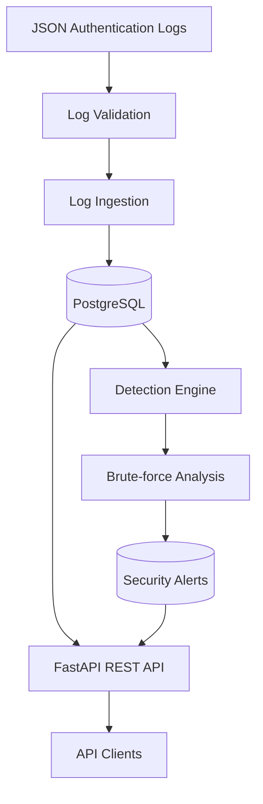
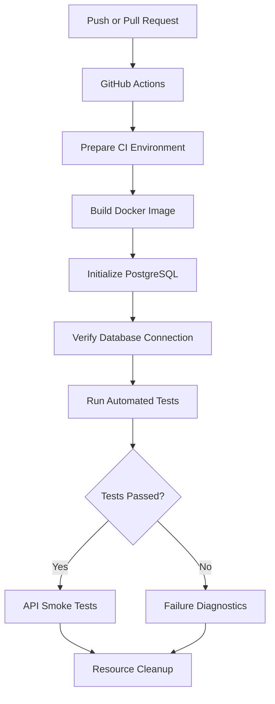

# Cloud Security Monitoring Platform

[](https://github.com/Mehmetxkck/cloud-security-monitor/actions/workflows/ci.yml)


## Overview

A Python-based security monitoring platform designed to
analyze authentication logs, detect brute-force attacks,
store security events, and provide security insights
through a REST API.

The project combines backend engineering, database
management, cybersecurity fundamentals, containerization,
performance benchmarking, and continuous integration.

## Tech Stack

| Technology | Purpose |
|------------|---------|
| Python | Backend development |
| FastAPI | REST API |
| PostgreSQL | Persistent data storage |
| Psycopg 3 | Database connectivity |
| Pydantic | Data validation |
| Pytest | Automated testing |
| Docker | Containerization |
| Docker Compose | Service orchestration |
| GitHub Actions | Continuous integration |
| Git | Version control |

## Features

### Security Monitoring

- JSON authentication log ingestion
- Structured log validation
- Failed login analysis
- IP-based aggregation
- Brute-force attack detection
- Persistent security alerts
- Duplicate alert prevention
- Time-based security statistics

### Backend Engineering

- RESTful API architecture
- PostgreSQL integration
- Database-level aggregation
- Pagination and IP filtering
- Duplicate log prevention
- Environment-based configuration
- Database error handling
- HTTP 503 responses for database connectivity failures

### Database Engineering

- PostgreSQL indexes
- SQL query optimization
- EXPLAIN ANALYZE benchmarking
- Isolated application, test, and benchmark databases
- Automated database initialization
- Persistent Docker volumes
- Synthetic benchmark dataset generation

### DevOps

- Dockerized FastAPI application
- PostgreSQL container
- Non-root application container
- Docker Compose orchestration
- PostgreSQL health checks
- Automated CI pipeline
- API smoke testing
- Failure diagnostics
- Automated CI resource cleanup

## System Architecture



## Detection Rule

The detection engine identifies potential brute-force
attacks when an IP address generates at least five
failed login attempts within a 60-second window.

Detected security alerts are stored in PostgreSQL.

## Database Isolation

The platform uses three separate PostgreSQL databases.

| Database | Purpose |
|----------|---------|
| security_monitor | Application data |
| security_monitor_test | Integration testing |
| security_monitor_benchmark | Performance benchmarking |

This separation prevents benchmark and test data from
interfering with application data.

## Project Structure

```text
cloud-security-monitor/
├── .github/
│   └── workflows/
│       └── ci.yml
├── app/
│   ├── config.py
│   ├── main.py
│   ├── database.py
│   ├── log_parser.py
│   ├── import_logs.py
│   ├── schemas/
│   └── services/
│       └── detection_engine.py
├── data/
│   └── sample_logs.json
├── docker/
│   └── postgres/
│       └── init/
│           ├── 01-init-databases.sh
│           └── schemas/
│               ├── app-schema.sql
│               ├── test-schema.sql
│               └── benchmark-schema.sql
├── scripts/
│   ├── generate_benchmark_data.py
│   ├── benchmark_large_dataset.py
│   └── benchmark_queries.py
├── tests/
├── .dockerignore
├── .env.example
├── .env.docker.example
├── .gitignore
├── Dockerfile
├── docker-compose.yml
├── requirements.txt
└── README.md
```

## Getting Started

### Prerequisites

- Git
- Docker
- Docker Compose

### Clone the Repository

```bash
git clone https://github.com/Mehmetxkck/cloud-security-monitor.git
cd cloud-security-monitor
```

### Configure Environment Variables

```bash
cp .env.docker.example .env.docker
```

Edit `.env.docker` and replace the example database
password with a strong development password.

Do not commit environment files containing credentials.

### Start the Application

```bash
docker compose --env-file .env.docker up -d --build
```

PostgreSQL databases and schemas are automatically
initialized when a new database volume is created.

### Access the Application

| Service | URL |
|---------|-----|
| REST API | http://localhost:8000 |
| Swagger UI | http://localhost:8000/docs |
| ReDoc | http://localhost:8000/redoc |
| Health endpoint | http://localhost:8000/health |

### Stop the Application

```bash
docker compose --env-file .env.docker down
```

Database data is preserved in the persistent Docker volume.

## API Endpoints

| Method | Endpoint | Description |
|--------|----------|-------------|
| GET | / | Application information |
| GET | /health | Application health check |
| GET | /logs | Retrieve and filter security logs |
| GET | /logs/failed | Failed login counts by IP |
| POST | /security/analyze | Run brute-force detection |
| GET | /security/alerts | Retrieve stored security alerts |
| GET | /security/stats | Retrieve security statistics |

### Example Requests

Retrieve logs:

```bash
curl "http://localhost:8000/logs?limit=10&offset=0"
```

Filter logs by IP address:

```bash
curl "http://localhost:8000/logs?ip_address=203.0.113.25"
```

Retrieve failed login counts:

```bash
curl http://localhost:8000/logs/failed
```

Run security analysis:

```bash
curl -X POST http://localhost:8000/security/analyze
```

Retrieve security alerts:

```bash
curl http://localhost:8000/security/alerts
```

Retrieve statistics for the last 24 hours:

```bash
curl "http://localhost:8000/security/stats?hours=24"
```

## Automated Testing

The project includes:

- Unit tests
- API tests
- PostgreSQL integration tests
- Detection engine tests
- Log validation tests
- Regression tests

Run tests inside Docker:

```bash
docker compose --env-file .env.docker exec -T api \
    python -m pytest -q -p no:cacheprovider
```

### Verified Test Results

| Metric | Result |
|--------|--------|
| Passed tests | 31 |
| Failed tests | 0 |
| Local testing | Passed |
| Docker testing | Passed |
| GitHub Actions testing | Passed |
| API smoke testing | Passed |

A Starlette/httpx deprecation warning is currently
tracked as a dependency maintenance item.

## Performance Benchmarking

The platform includes a synthetic dataset containing
10,000 security log records for database performance
experiments.

Generate benchmark data:

```bash
docker compose --env-file .env.docker exec -T api \
    python -m scripts.generate_benchmark_data
```

Run dataset benchmarks:

```bash
docker compose --env-file .env.docker exec -T api \
    python -m scripts.benchmark_large_dataset
```

Analyze PostgreSQL query performance:

```bash
docker compose --env-file .env.docker exec -T api \
    python -m scripts.benchmark_queries
```

Benchmarking focuses on:

- Sequential scans
- Index scans
- Query execution time
- Mean and median latency
- PostgreSQL query execution plans

Benchmark results depend on dataset characteristics,
query selectivity, indexes, and execution environment.

## Continuous Integration

GitHub Actions automatically runs the CI pipeline on
pushes to main, pull requests targeting main, and
manual workflow dispatches.



### CI Validation

- Docker image build
- PostgreSQL initialization
- Application readiness
- Database connectivity
- Automated tests
- API smoke tests
- Failure diagnostics
- Resource cleanup

An intentional failing test was used in an isolated
branch to verify CI failure detection and cleanup.

The temporary test is not intended to be part of main.

## Security Considerations

- Environment-based credential management
- Parameterized SQL queries
- Input validation
- Non-root application container
- Isolated databases
- Localhost-only API port binding
- No publicly exposed PostgreSQL port
- Restricted GitHub Actions token permissions
- Randomly generated CI database credentials

This project is a development-stage security monitoring
platform and is not yet hardened for production use.

## Roadmap

### Completed

- [x] Python backend fundamentals
- [x] Log ingestion and validation
- [x] PostgreSQL integration
- [x] Brute-force detection
- [x] Persistent security alerts
- [x] Duplicate prevention
- [x] REST API development
- [x] Pagination and filtering
- [x] Time-based security statistics
- [x] Database indexing
- [x] Performance benchmarking
- [x] Database isolation
- [x] Environment configuration
- [x] Docker containerization
- [x] Automated testing
- [x] GitHub Actions CI
- [x] CI failure simulation

### Planned

- [ ] Database migrations
- [ ] Improved benchmark reproducibility
- [ ] Database least-privilege roles
- [ ] Database-aware readiness checks
- [ ] Authentication and authorization
- [ ] API rate limiting
- [ ] Background security analysis
- [ ] Structured logging
- [ ] Monitoring and observability
- [ ] Cloud infrastructure
- [ ] Infrastructure as Code
- [ ] Automated cloud deployment
- [ ] Cloud security integrations

## Project Objective

This project is designed as a practical engineering
portfolio demonstrating skills in:

- Python Backend Engineering
- Database Engineering
- Security Engineering
- DevOps
- Cloud Security
- Software Testing
- System Design

The long-term goal is to evolve the platform into a
cloud-based security monitoring system.

## Author

Mehmet Koçak

Software Engineering Student

GitHub: https://github.com/Mehmetxkck